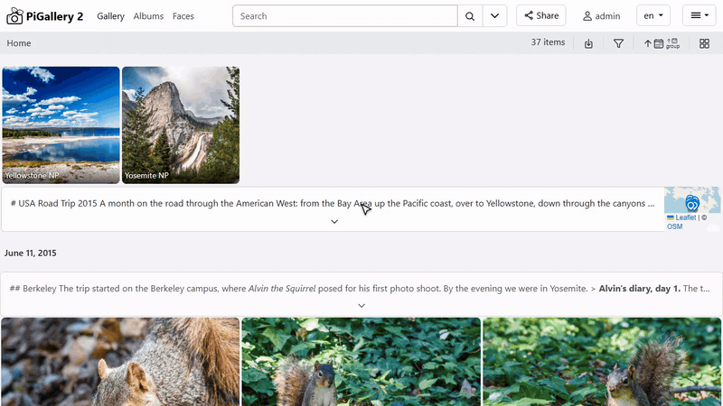

# PiGallery2

[](https://coveralls.io/github/bpatrik/pigallery2?branch=master)
[](https://github.com/bpatrik/pigallery2/actions)
[](https://github.com/sponsors/bpatrik)
[](https://ko-fi.com/pigallery2)

A fast, directory-first, self-hosted photo gallery, built for low-resource servers like the Raspberry Pi.
Point it at your photo folder and browse it as it is: PiGallery2 never modifies your photos.

[Documentation](https://bpatrik.github.io/pigallery2/) ·
[Live demo](https://pigallery2.onrender.com/) (the demo server sleeps when idle, so the first load may take up to 60 seconds)



## 🚀 Key features

- **⚡ Fast**: optimized for low-end hardware.
- **✔️ Simple**: point it to your photos and you are ready.
- **📁 Directory-first**: shows your folder structure as it is.
- **🔒 Read-only**: your photo folder is never modified.

Map, search, sharing, albums, faces and more: see the [full feature list](https://bpatrik.github.io/pigallery2/features).

## 🏁 Getting started

Docker is the supported way to run PiGallery2 (`amd64` and `arm64v8` images):

```bash
docker run -d -p 80:80 \
  -v <config folder>:/app/data/config \
  -v <db folder>:/app/data/db \
  -v <photos folder>:/app/data/images:ro \
  -v <temp folder>:/app/data/tmp \
  bpatrik/pigallery2:latest
```

Then open `http://localhost`, log in with `admin` / `admin` and change the password in the settings.

PiGallery2 does not rate limit requests itself, so put a reverse proxy in front of it before you expose it to the internet.
The [Docker guide](https://bpatrik.github.io/pigallery2/setup/docker) has a docker-compose setup with nginx and HTTPS.
A [native install](https://bpatrik.github.io/pigallery2/setup/direct-install) is possible, but not supported.

## 📖 Documentation

- [Features](https://bpatrik.github.io/pigallery2/features)
- [FAQ](https://bpatrik.github.io/pigallery2/faq)
- [Configuration](https://bpatrik.github.io/pigallery2/user-guide/configuration)
- [User rights](https://bpatrik.github.io/pigallery2/user-guide/user-rights)

## 📱 Apps & 3rd party tools

- **Install it as an app**: PiGallery2 is a PWA, so you can install it on your phone as it is (browser menu -> *Add to Home screen*).
- **[Extensions](extension/REPOSITORY.md)**: community extensions that you can install from the settings page.
- **[Native Android app](https://github.com/dasmaetthes/pigallery2_android)**: a community-made Android (and Android TV) client.

3rd party tools are not maintained by me, and I take no responsibility for them. [More details](https://bpatrik.github.io/pigallery2/third-party).

## 🤝 Contributing

Bug fixes are welcome. I mostly merge bug fixes: to keep the app simple, a new feature should be a setting,
a theme or an [extension](https://bpatrik.github.io/pigallery2/development/extensions) when possible.
Please read the [contribution guide](https://bpatrik.github.io/pigallery2/development/contributing) before you start.
Using an AI coding agent? See [AGENTS.md](AGENTS.md).

## ❤️ Support

PiGallery2 is free, and I build it alone in my free time, which, since my daughter was born, mostly means nap time 👶.
WebStorm and AI coding agents help me make the most of those short windows.

If PiGallery2 makes your photos a bit nicer to browse, consider ❤️ [sponsoring me on GitHub](https://github.com/sponsors/bpatrik)
or ☕ [buying me a coffee on Ko-fi](https://ko-fi.com/pigallery2).
A coffee is plenty, and pizza or a date night with my wife is even better 🍕.

## Star history

[](https://www.star-history.com/#bpatrik/pigallery2&type=date&legend=top-left)

## License

[MIT](LICENSE)
