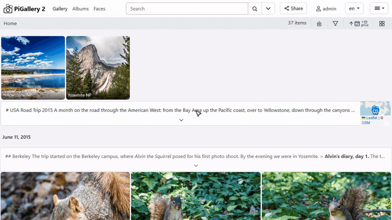

---
hide:
  - navigation
  - toc
---

# PiGallery2

A **fast**, directory-first, self-hosted photo gallery, built for low-resource servers like the Raspberry Pi.
Point it at your photo folder and browse it as it is: PiGallery2 never modifies your photos.

[Get started](setup/docker.md){ .md-button .md-button--primary }
[Try the live demo](https://pigallery2.onrender.com/){ .md-button }

<small>The demo server sleeps when idle, so the first load may take up to 60 seconds.</small>

## Explore the docs

-   :material-image-multiple-outline:{ .lg .middle } **Features**

    ---

    The photo viewer, map, search, sharing, albums, faces and everything else PiGallery2 can do.

    [:octicons-arrow-right-24: Features](features.md)

-   :material-docker:{ .lg .middle } **Getting started**

    ---

    Install PiGallery2 with Docker (recommended) or directly on the host.

    [:octicons-arrow-right-24: Install with Docker](setup/docker.md)

-   :material-cog-outline:{ .lg .middle } **User guide**

    ---

    Every setting of the app, and what each user role and sharing link can see.

    [:octicons-arrow-right-24: Configuration](user-guide/configuration.md)

-   :material-frequently-asked-questions:{ .lg .middle } **FAQ**

    ---

    Why there are no classic albums, why the database gets rebuilt, and how releases work.

    [:octicons-arrow-right-24: FAQ](faq.md)

-   :material-puzzle-outline:{ .lg .middle } **Extensions & development**

    ---

    Extend PiGallery2 with your own extension, or contribute to the app itself.

    [:octicons-arrow-right-24: Development](development/contributing.md)

-   :material-post-outline:{ .lg .middle } **Blog**

    ---

    How the maintainer runs PiGallery2, and where the project is heading.

    [:octicons-arrow-right-24: Blog](blog/from-zero-to-hero-2025.md)

## Support the project

PiGallery2 is free, and I build it alone in my free time, which, since my daughter was born, mostly means nap time 👶.
WebStorm and AI coding agents help me make the most of those short windows.

If PiGallery2 makes your photos a bit nicer to browse, consider [sponsoring me on GitHub](https://github.com/sponsors/bpatrik) or [buying me a coffee on Ko-fi](https://ko-fi.com/pigallery2).
A coffee is plenty, and pizza or a date night with my wife is even better 🍕.
