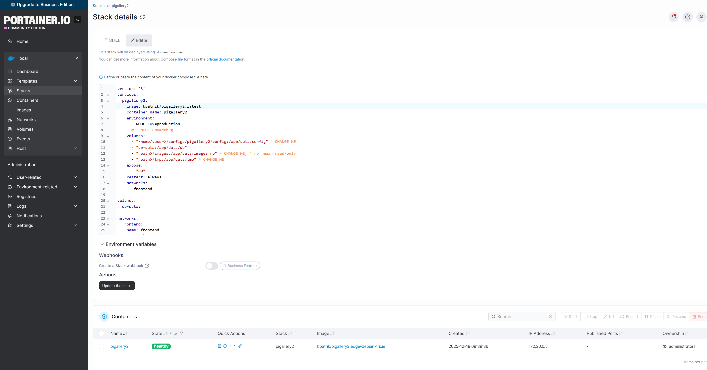
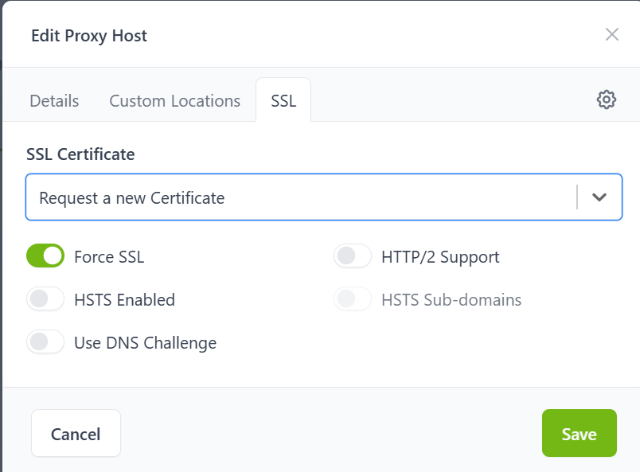

# Advanced Setup: Portainer and NPM

This tutorial covers an advanced deployment scenario using **Portainer** for container management and **Nginx Proxy Manager (NPM)** as a reverse proxy.

This setup is ideal for users who want:

- A GUI to manage Docker containers (Portainer).
- Automatic SSL/TLS certificates (NPM + Let's Encrypt).
- Optimized Nginx configuration for PiGallery2.
- A shared configuration structure.

---

## Prerequisites

1.  **Docker and Docker Compose** installed on your server.
2.  **A Domain Name** with DNS records pointing to your server's IP address.
3.  **Ports 80 and 443** open on your firewall. Keep the admin ports of Portainer (9443) and NPM (81) closed to the internet: reach them from your local network or through a VPN.

---

## Preparation

It is recommended to keep all configuration files in a centralized location for easy backups.

```bash
mkdir -p ~/configs/nginx-proxy-manager/data
mkdir -p ~/configs/nginx-proxy-manager/letsencrypt
mkdir -p ~/configs/pigallery2/config
```

---

## 1. Portainer Setup

Portainer provides a web UI for managing Docker stacks, containers, and networks.

### Deploy Portainer

Run the following command to start Portainer:

```bash
docker run -d -p 9443:9443 --name portainer --restart=always -v /var/run/docker.sock:/var/run/docker.sock -v portainer_data:/data portainer/portainer-ce:latest
```

Access it at `https://<your-server-ip>:9443`.

---

## 2. Shared Network

To allow NPM to communicate with other containers, we use a shared Docker network named `frontend`.

In Portainer, go to **Networks** -> **Add network**:

- **Name:** `frontend`
- **Driver:** `bridge`

---

## 3. Nginx Proxy Manager (NPM) Stack

NPM will handle SSL termination and routing.

In Portainer, create a new **Stack** (Docker Compose) named `nginx-proxy-manager`:


```yaml
version: '3.8'
services:
  app:
    container_name: nginx-proxy-manager
    image: 'jc21/nginx-proxy-manager:latest'
    restart: unless-stopped
    ports:
      - '80:80'
      - '81:81'
      - '443:443'
    volumes:
      - /home/<user>/configs/nginx-proxy-manager/data:/data
      - /home/<user>/configs/nginx-proxy-manager/letsencrypt:/etc/letsencrypt
    networks:
      - frontend

networks:
  frontend:
    external: true
```
*Replace `<user>` with your actual username.*

---

## 4. PiGallery2 Stack

Deploy PiGallery2 and connect it to the `frontend` network.

Create a new **Stack** named `pigallery2` and copy the content of [this compose file (original)](https://github.com/bpatrik/pigallery2/blob/master/docker/docker-compose/pigallery2-only/docker-compose.yml):



```yaml
version: '3'
services:
  pigallery2:
    image: bpatrik/pigallery2:latest
    container_name: pigallery2
    deploy:
      resources:
        limits:
          memory: 3G # <1GB RAM might also work. It will trigger GC more often. GC is slow. See https://github.com/bpatrik/pigallery2/issues/1080
    environment:
      - NODE_ENV=production # set to 'debug' for full debug logging
      - Server-trustProxy=uniquelocal # log the client's IP, not NPM's (see "Client IP in the logs" below)
      # - NODE_OPTIONS=--enable-source-maps # enable source map support on the backend for development
    volumes:
      - "/home/<user>/configs/pigallery2/config:/app/data/config"
      - "db-data:/app/data/db"
      - "/mnt/images:/app/data/images:ro" # Path to your photos
      - "/mnt/pigallery2-tmp:/app/data/tmp" # Path to a tmp folder
    expose:
      - "80"
    restart: always
    networks:
      - frontend

volumes:
  db-data:

networks:
  frontend:
    external: true
```

---

## 5. Configuring NPM

Access the NPM admin interface at `http://<your-server-ip>:81`.

### Add PiGallery2 Proxy Host

1.  **Domain Names:** `photos.yourdomain.com`
2.  **Scheme:** `http`
3.  **Forward Hostname / IP:** `pigallery2`
4.  **Forward Port:** `80`
5.  **SSL Tab:** Select "Request a new SSL Certificate", enable "Force SSL", "HTTP/2 Support" and "HSTS Enabled".

]


#### Rate limiting
PiGallery2 does not limit the request rate itself (e.g. password guessing on the login page), it relies on the reverse proxy for that.
The rate limits need zones on the `http` level of nginx, which NPM reads from `/data/nginx/custom/http_top.conf`.
Create `~/configs/nginx-proxy-manager/data/nginx/custom/http_top.conf` with:

```nginx
# The limits are per client IP. Raise them if many users share one IP (e.g. an office behind a NAT).
# login attempts (password guessing): 1 per second on average
limit_req_zone $binary_remote_addr zone=pigallery2_login:10m rate=1r/s;
# everything else. Opening a folder loads many thumbnails at once, so keep it generous.
limit_req_zone $binary_remote_addr zone=pigallery2_api:10m rate=50r/s;
limit_req_status 429;
```

Then restart the NPM stack so it reads the file.

#### Advanced Tab
Paste the following to enable Gzip compression, rate limiting and handle API/UI routing correctly
(the same as the [default nginx.conf](https://github.com/bpatrik/pigallery2/blob/master/docker/docker-compose/default/nginx.conf)):


```nginx
# text/html is always compressed. Photos and videos are already compressed, so they are not listed.
gzip on;
gzip_proxied any;
gzip_comp_level 6;
gzip_types
    text/css
    text/plain
    text/javascript
    text/markdown
    application/javascript
    application/json
    application/manifest+json
    application/gpx+xml
    application/xml
    image/svg+xml
    image/x-icon;

# Browsers don't guess the type of a file (e.g. don't run an uploaded file as a script).
add_header X-Content-Type-Options "nosniff" always;

# Login of users and of password protected sharings: limited strictly to slow down password guessing.
# Case-insensitive (~*), as PiGallery2 also accepts e.g. /pgapi/USER/login.
# NOTE: change '/pgapi' here too if you changed Server.apiPath or Server.urlBase.
location ~* ^/pgapi/(user|share)/login/?$ {
    limit_req zone=pigallery2_login burst=10 nodelay;
    proxy_pass http://pigallery2:80;
    proxy_http_version 1.1;
    proxy_set_header Host $host;
    # the client IP for PiGallery2's logs (e.g. failed logins), see Server.trustProxy
    proxy_set_header X-Forwarded-For $remote_addr;
    proxy_set_header X-Forwarded-Proto $scheme;
}

# API handles all methods (GET, POST, PUT, DELETE, etc.)
location /pgapi {
    # uploads: NPM allows 2000 MB bodies, this sends them on without storing the whole file first
    proxy_request_buffering off;
    limit_req zone=pigallery2_api burst=500 nodelay;
    proxy_pass http://pigallery2:80;
    proxy_http_version 1.1;
    proxy_set_header Host $host;
    proxy_set_header X-Forwarded-For $remote_addr;
    proxy_set_header X-Forwarded-Proto $scheme;
}

# UI is restricted to GET (and HEAD) for security
location / {
    limit_except GET {
        deny all;
    }
    limit_req zone=pigallery2_api burst=500 nodelay;
    proxy_pass http://pigallery2:80;
    proxy_http_version 1.1;
    proxy_set_header Host $host;
    proxy_set_header X-Forwarded-For $remote_addr;
    proxy_set_header X-Forwarded-Proto $scheme;
}
```

**Note:** create `http_top.conf` first: without its zones nginx rejects the `limit_req` lines of the Advanced tab.

#### Client IP in the logs
PiGallery2 logs the IP of failed logins (useful e.g. for Fail2Ban). Behind a proxy it only sees the proxy's IP,
unless you tell it to trust the proxy. The compose file above does this with `Server-trustProxy=uniquelocal`
(or set `Server.trustProxy` in Settings → Server, "Under the hood" mode).
That trusts the `X-Forwarded-For` header from private network addresses, like the Docker network of NPM.
Don't set it to `true`: then any client can fake its IP.

---

## 6. Fail2Ban (Optional)

Rate limiting slows password guessing down; [Fail2Ban](https://github.com/fail2ban/fail2ban) bans the IPs that keep failing.
PiGallery2 logs every failed login with the client IP, and Fail2Ban on the Docker host bans those IPs before they reach NPM.
More background and other setups: [Fail2Ban guide](fail2ban.md).

### Send PiGallery2's log to the journal

In the `pigallery2` stack, check that `Server-trustProxy=uniquelocal` is set (see above) and add a `logging` section to the service.
The fixed tag keeps working when Portainer re-creates the container, unlike the container's own log file:

```yaml
services:
  pigallery2:
    # ... as above
    logging:
      driver: journald
      options:
        tag: pigallery2
```

Update the stack, fail a login from outside your network (e.g. a phone on mobile data) and check that the logged IP is the phone's
public IP, not a `172.x` Docker address:

```bash
journalctl CONTAINER_TAG=pigallery2 | grep "Failed login"
```

### Install Fail2Ban on the Docker host

```bash
sudo apt install fail2ban python3-systemd
```

`/etc/fail2ban/filter.d/pigallery2.conf`:

```ini
[Definition]
failregex = ^.*?\bAuthenticationMWs Failed login from IP `<ADDR>`(?: for user:| with sharing:| no user or password provided)
ignoreregex =

[Init]
journalmatch = CONTAINER_TAG=pigallery2
```

`/etc/fail2ban/jail.d/pigallery2.local`:

```ini
[pigallery2]
enabled  = true
filter   = pigallery2
backend  = systemd
# NPM's ports 80 and 443 are published by Docker, so the traffic skips the INPUT chain: ban in DOCKER-USER
banaction = iptables-multiport
chain    = DOCKER-USER
port     = http,https
maxretry = 5
findtime = 10m
bantime  = 1h
bantime.increment = true
# never ban your own network (add your VPN's range too)
ignoreip = 127.0.0.1/8 ::1 192.168.0.0/16 10.0.0.0/8 172.16.0.0/12
```

Restart it and check the jail:

```bash
sudo systemctl restart fail2ban
sudo fail2ban-regex systemd-journal /etc/fail2ban/filter.d/pigallery2.conf
sudo fail2ban-client status pigallery2
```

A ban blocks the IP for everything behind NPM (ports 80 and 443), not only for PiGallery2.
Unban an IP with `sudo fail2ban-client set pigallery2 unbanip <ip>`.

---

## Summary

With this setup, you have:

- **Portainer** to easily manage and update your containers.
- **Nginx Proxy Manager** providing SSL and routing.
- **PiGallery2** securely accessible via your own subdomain.
- A **shared Docker network** allowing internal communication between the proxy and the app.
