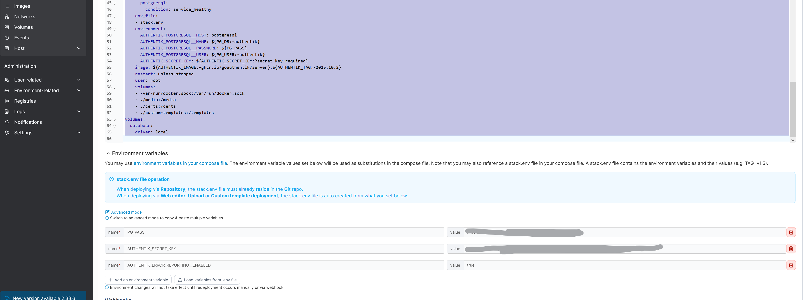
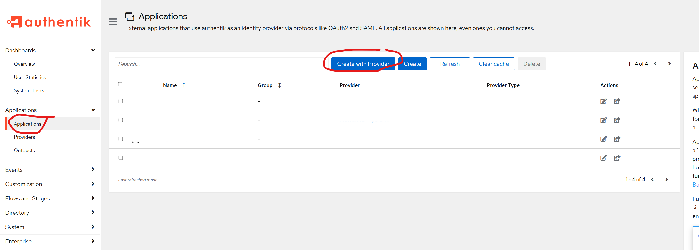
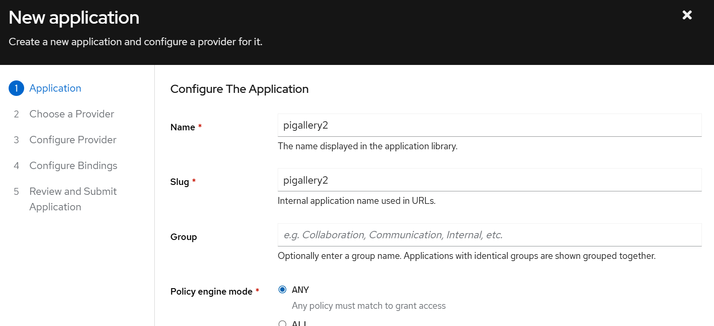
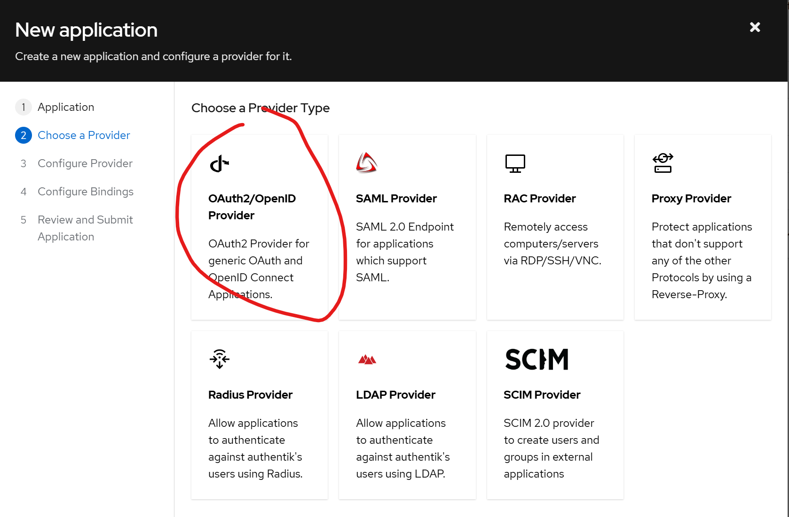
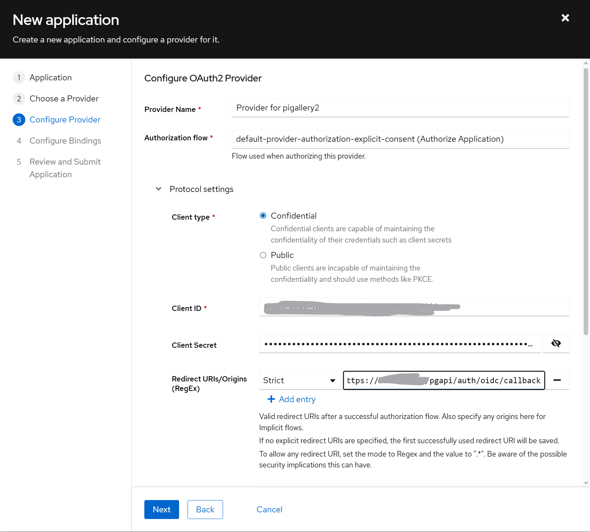
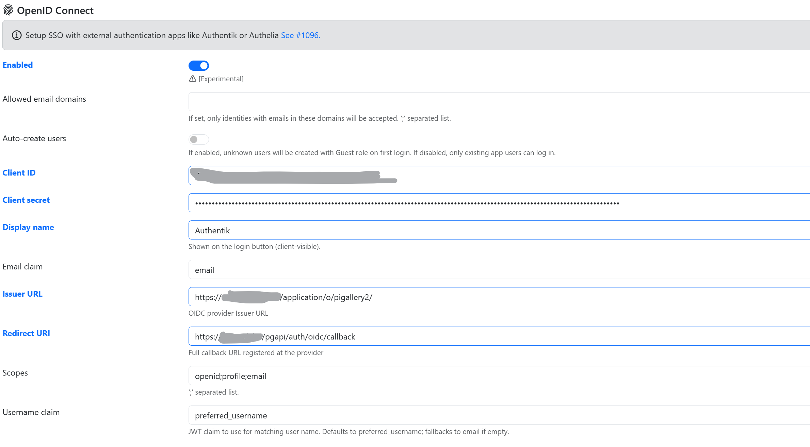

# Authentik Setup (Optional)

If you run multiple self-hosted services, you may want **Single Sign-On (SSO)**. [Authentik](https://goauthentik.io/) is a great choice and integrates cleanly with PiGallery2 via **OpenID Connect (OIDC)**.

## Deploy Authentik

In Portainer, create a new **Stack** for Authentik. It is recommended to use the latest `docker-compose.yml` from the [official Authentik documentation](https://docs.goauthentik.io/install-config/install/docker-compose/).

Key configuration points for PiGallery2 integration:

- Ensure Authentik is on the `frontend` network if you want NPM to route to it internally.
- In Authentik, create a new **OAuth2/OpenID Provider**.
- Set the **Redirect URI** to: `https://photos.yourdomain.com/pgapi/auth/oidc/callback`

## Configure PiGallery2 for OIDC

In the PiGallery2 web interface, go to **Settings** -> **Users** and enable **OpenID Connect**. Use the Client ID, Client Secret, and Issuer URL provided by Authentik.

## Who can log in as whom

By default, PiGallery2 matches the OIDC login to an app user by name (the `preferred_username` claim, or the part of the email before the `@`).
This is safe if you trust everyone who has an account at your provider and they can't change their own username.

If that is not the case (e.g.: open registration, or users can rename themselves), enable **Strict security** under the OpenID Connect settings:

- On the first OIDC login, the app user gets linked to the provider account. Later logins only work from that account.
- Only users up to **Max role for linking** (default: User) get linked by name. To link an admin, raise it to Admin, log in once with OIDC, then set it back.
- The email fallback uses the full, verified email address.
- If you reinstall your provider, the accounts get new ids: use the unlink button in **Settings** -> **Users** to let them link again.
